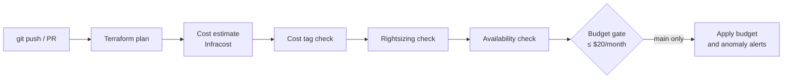

# AWS cost optimisation without losing availability

Every change to the infrastructure is priced and checked before it can merge: is it tagged so the bill can be split by team,
is it the right size, does it scale with load, and does it still survive losing an Availability Zone?
On `main`, the pipeline also keeps an AWS budget and cost anomaly alerts in place.

[Live pipeline →](https://danielkojomegbenu.com/projects/aws-cost-optimisation)

## The pipeline



| Step | What happens | Fails the run when |
|---|---|---|
| 1. Terraform plan | Plans the web tier in `infra/workload` (never applied) and the guardrails in `infra/guardrails` | The code doesn't format, validate or plan |
| 2. Cost estimate | Infracost prices the plan and posts the monthly cost on the pull request | |
| 3. Cost tag check | Every resource, and every instance and disk Auto Scaling launches, has `Project`, `CostCenter`, `Owner` and `Environment` | A tag is missing, so the cost can't be traced to a team |
| 4. Rightsizing check | Small burstable instances (t4g, t3, t3a up to medium), small gp3 disks, scaling that follows load, and a scale-down for quiet hours | Someone picks an oversized instance or drops autoscaling |
| 5. Availability check | Two Availability Zones, at least 2 instances by day, never scaled to 0 | A saving would put availability at risk |
| 6. Budget gate | The Infracost estimate must fit the monthly budget | The change would cost more than $20/month |
| 7. Apply (main only) | Keeps a monthly AWS Budget and Cost Anomaly Detection in place, both alerting the `cost-alerts` SNS topic | |

## Where the savings come from

The web tier in [`infra/workload/main.tf`](infra/workload/main.tf) shows each lever:

| Lever | In the code |
|---|---|
| Cost tagging | `default_tags` on the provider, plus tags on everything Auto Scaling launches |
| Rightsizing | `t4g.micro`, an arm64 Graviton instance, with an 8 GB gp3 disk |
| Auto Scaling | 2 to 4 instances, keeping average CPU near 50% |
| Quiet hours | Scales down to 1 instance at night and over weekends, then back to 2 at 07:00 UTC on weekdays |
| Availability | Spread over two Availability Zones, never below 1 instance |

The same web tier sized the usual way, with two always-on `m5.large` instances, costs about $140/month. This one is about $13.

## See a check stop the pipeline

Open the pull request **demo/oversized-instance**. It changes the instance to `m5.2xlarge`.
Infracost posts the new monthly cost on the PR, then the **Rightsizing check** fails and nothing is applied.

## Set it up in your own account

1. Create the two IAM roles GitHub Actions uses, one for planning and one for applying. They use OIDC, so no access keys are stored:
   ```bash
   cd infra/bootstrap
   terraform init && terraform apply
   ```
   Change `github_sub_prefix` and `state_bucket` first. The comments in the file show how to find your values.
2. Get a free Infracost API key (`infracost auth login`) and save it as the repo secret `INFRACOST_API_KEY`.
3. Push to `main`. To get the alerts, subscribe your email to the `cost-alerts` SNS topic.

## What's in the repo

| Path | What it is |
|---|---|
| `infra/workload/` | The web tier the pipeline prices and checks. It is never applied |
| `infra/guardrails/` | The budget, anomaly monitor and alert topic, applied from `main` |
| `infra/bootstrap/` | The two OIDC roles, applied once by hand |
| `policy/check.py` | The tag, rightsizing, availability and budget checks (plain Python, no packages) |
| `.github/workflows/cost-guardrails.yml` | The pipeline |

## Cost

Free. The web tier is only planned, never created. AWS Budgets, Cost Anomaly Detection and an SNS topic cost nothing at this size,
Infracost's CLI is free, and GitHub Actions is free for public repos.
